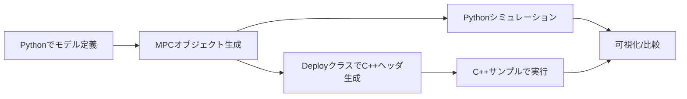

# 1. 全体像とディレクトリ構成

## 何をするライブラリか

このリポジトリは、Pythonで定義したMPCコントローラをベースに、

- Pythonシミュレーションで挙動確認
- C++ヘッダ生成
- C++で同等インターフェースで実行

までを一連で進めるための構成です。

## 主要ディレクトリの役割

| ディレクトリ | 役割 |
|---|---|
| `mpc_utility` | LTV/Adaptive向けの補助コード生成（更新器・パラメータ構造体生成など） |
| `python_mpc` | Linear / Adaptive / Nonlinear MPC の C++コード生成エントリ |
| `sample` | Python側の利用例と、対応するC++実行例 |
| `external_libraries` | 制御・最適化・行列・コード生成の基盤ライブラリ |

## 全体フロー

## sample の見方

`sample` では、基本的に各テーマごとに

- `*.py`: Pythonでモデル作成・MPC実行・ヘッダ生成
- `*.cpp`: 生成済みヘッダを読み込んでC++で実行

のペアになっています。

例:

- `sample/lti_no_constraints/state_space_SISO.py` と `sample/lti_no_constraints/state_space_SISO.cpp`
- `sample/nonlinear/simple_pendulum.py` と `sample/nonlinear/simple_pendulum.cpp`

## MPCタイプ別の入口

| 種別 | Python側の主なクラス | Deployクラス |
|---|---|---|
| LTI（制約なし） | `LTI_MPC_NoConstraints` | `LinearMPC_Deploy.generate_LTI_MPC_NC_cpp_code` |
| LTI（制約あり） | `LTI_MPC` | `LinearMPC_Deploy.generate_LTI_MPC_cpp_code` |
| LTV（制約なし） | `LTV_MPC_NoConstraints` | `LinearMPC_Deploy.generate_LTV_MPC_NC_cpp_code` |
| LTV（制約あり） | `LTV_MPC` | `LinearMPC_Deploy.generate_LTV_MPC_cpp_code` |
| Adaptive（制約なし） | `AdaptiveMPC_NoConstraints` | `AdaptiveMPC_Deploy.generate_Adaptive_MPC_NC_cpp_code` |
| Adaptive（制約あり） | `AdaptiveMPC` | `AdaptiveMPC_Deploy.generate_Adaptive_MPC_cpp_code` |
| Nonlinear（SQP） | `NonlinearMPC_TwiceDifferentiable` | `NonlinearMPC_TwiceDifferentiableDeploy.generate_Nonlinear_MPC_cpp_code` |
| Nonlinear（OpEn） | `NonlinearMPC_OptimizationEngine` | `NonlinearMPC_OptimizationEngineDeploy.generate_Nonlinear_MPC_cpp_code` |
