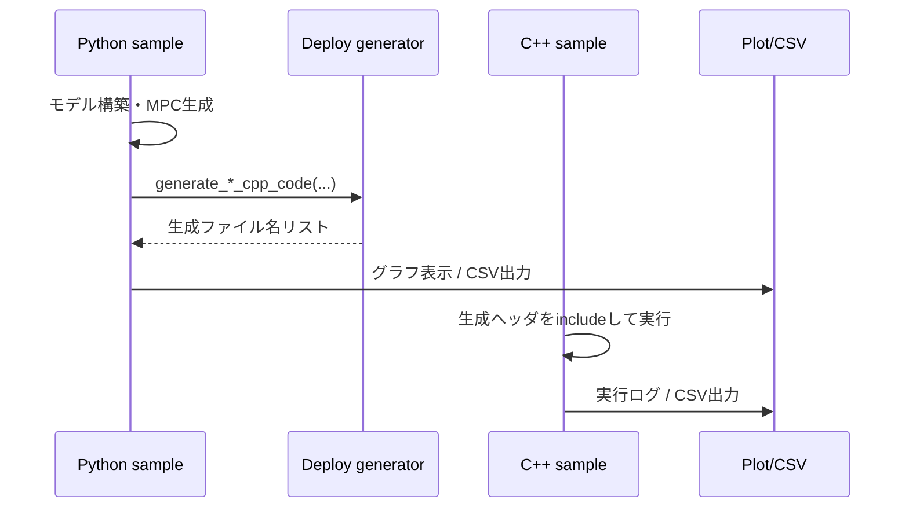

# 6. シミュレーションと実行フロー

この章は、`sample` の実行手順を Python → C++ の順に整理します。

## 実行フロー

## Python実行時にやっていること

多くのサンプルで共通です。

1. モデルとMPCオブジェクトを作る
2. `generate_*_cpp_code(...)` でヘッダ生成
3. 制御ループで `update(...)` / `update_manipulation(...)`
4. `SimulationPlotterDash` へ系列を追加して描画

## C++実行時にやっていること

1. 生成ヘッダを `#include`
2. `auto mpc = xxx::make();`
3. `Reference_Type` または `ReferenceTrajectory_Type` を準備
4. ループで `update` / `update_manipulation`

## 参照信号・可視化ユーティリティ

`sample/simulation_manager` は以下の補助を担当しています。

| モジュール | 役割 |
|---|---|
| `signal_edit/sampler.py` | パルスなどの参照信号生成 |
| `visualize/simulation_plotter_dash.py` | Dashベースの多軸可視化 |
| `visualize/simulation_plotter_matplotlib.py` | Matplotlibベース可視化 |

## Python/C++ 比較を行うサンプル

`sample/nonlinear/kinematic_bicycle_model.py` と
`sample/nonlinear/kinematic_bicycle_model_op_en.py` は、

- Python実行結果のプロット
- C++実行結果CSV（`cpp_run_data*.csv`）読込
- 同一グラフ上で比較

まで含んでいます。移植結果検証のテンプレートとして使えます。
