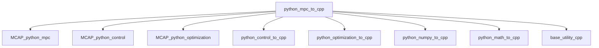

# 7. 利用している外部ライブラリ要約

本リポジトリは複数の外部ライブラリを利用しています。
ここでは、本リポジトリでの使われ方に絞って要点のみ再掲します。

## 依存関係の概略

## 各ライブラリの役割

| ライブラリ | 本リポジトリでの主用途 |
|---|---|
| `external_libraries/MCAP_python_control` | 状態空間・Kalman Filter 等の制御基盤 |
| `external_libraries/MCAP_python_optimization` | PANOC/ALM/QP/SQP 等の最適化基盤 |
| `external_libraries/python_control_to_cpp` | control系クラスのC++コード生成 |
| `external_libraries/python_optimization_to_cpp` | 最適化設定・行列のC++コード生成 |
| `external_libraries/python_numpy_to_cpp` | NumPy行列をC++行列表現へ変換 |
| `external_libraries/python_math_to_cpp` | 数学関数群のC++側補助 |
| `external_libraries/base_utility_cpp` | 近傍ゼロ判定・コピー・ソート等の基礎ユーティリティ |
| `external_libraries/MCAP_python_mpc` | MPC本体のPython実装（LTI/LTV/Adaptive/Nonlinear） |

## `python_mpc_to_cpp` 側との接点

- `python_mpc/*.py`
  各種MPCオブジェクトを入力に、control/optimization/numpy系生成器を統合して最終ヘッダを出力
- `mpc_utility/*.py`
  LTV/Adaptive向け更新器コード（状態空間更新、Phi/F更新、parameter構造体）を生成
- `sample/*.py`
  実際のMPC利用フローとコード生成呼び出しの実例

## 補足

このリポジトリのドキュメントは、外部ライブラリ側ドキュメントに依存せず読めるように構成しています。
必要な情報は各章（特に [2](./02_linear_mpc_usage.md), [3](./03_adaptive_mpc_usage.md), [4](./04_nonlinear_mpc_usage.md), [5](./05_code_generation_and_cpp_interface.md)）に再整理しています。
